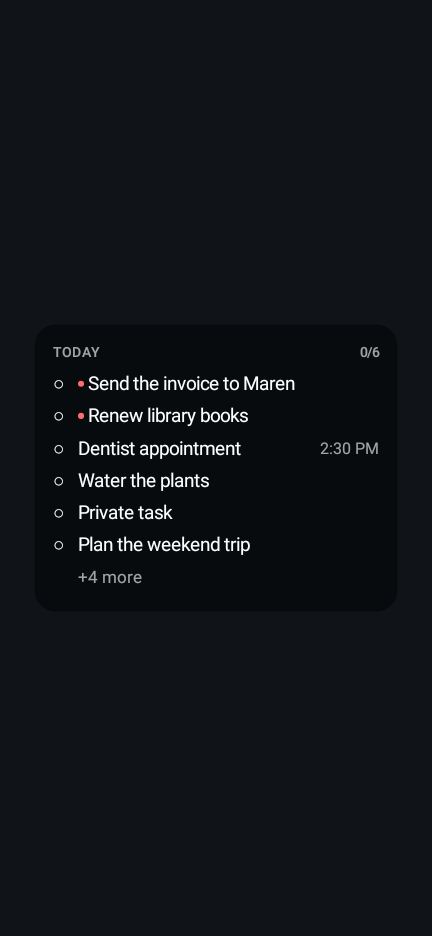
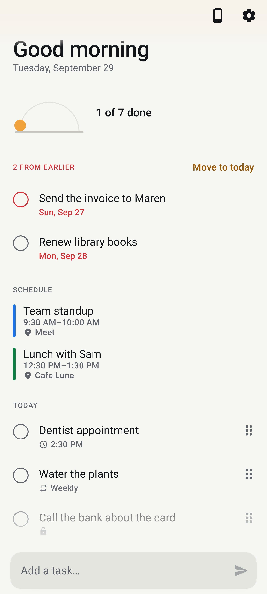
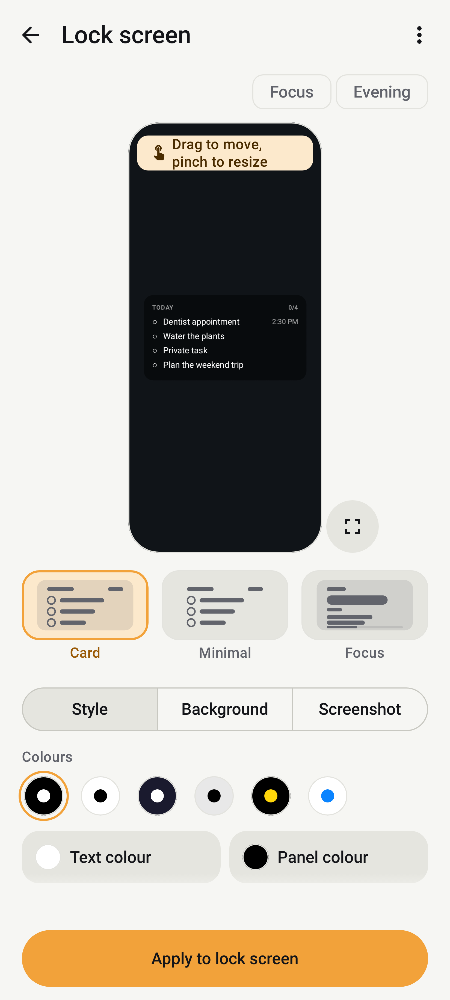
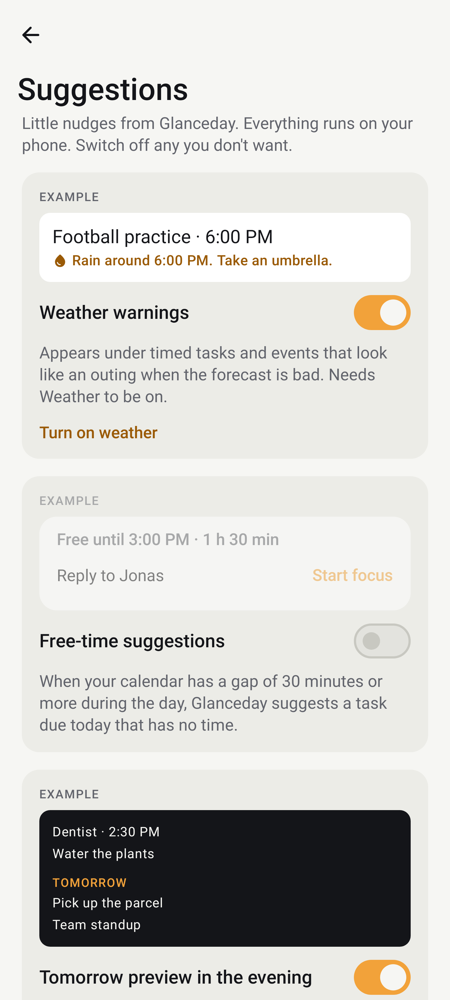

# Glanceday

**Your day, before you unlock.**

Glanceday puts your to-do list on your lock-screen wallpaper. One glance at your phone shows what's next, without opening an app. It stays up to date as you tick things off.

  
  
  
  

## What it does

- **Your list on the lock screen.** Today's tasks are drawn into your lock-screen wallpaper, over your own photo or a plain colour. Drag and pinch to place it around your clock.
- **Quick add that understands you.** "Dentist tomorrow 3pm", "call mum friday #personal", or in Dutch: "morgen om 15u".
- **Calendar, weather and widgets.** See today's events next to your tasks, a one-line forecast, and home-screen widgets in three sizes.
- **Focus timer.** Pick a task, start 25 minutes, and it shows on your lock screen until you're done.
- **Lists with hours.** A Work list can show only on weekdays from 9 to 5.
- **Gentle suggestions, all switchable.** A heads-up when rain meets an outing, a task for a free gap in your calendar, a morning brief, an evening plan. Each one has its own switch.
- **Subtasks, repeats, reminders, backup and restore.** English and Dutch.

## Install

1. Open [Releases](../../releases/latest) and download `glanceday-<version>.apk` on your phone.
2. Open the file. Android will ask to allow installs from your browser or file manager: allow it once.
3. Open Glanceday and follow the three short setup steps.

Android 8.0 or newer. Tested on a Galaxy S24 Ultra (One UI 8.5) and on Pixel images (Android 16).

**Updates:** Glanceday doesn't update itself. Watch this repo (Watch → Custom → Releases), or add it to [Obtainium](https://github.com/ImranR98/Obtainium) with this repo's URL to get updates automatically.

## Permissions, and why

| Permission | Why |
|---|---|
| Set wallpaper | To draw your list on the lock screen. Only the lock-screen wallpaper is changed. |
| Notifications | Reminders, the optional list notification, focus timer and daily brief. |
| Alarms & reminders | To remind you at the exact minute. Optional. |
| Calendar (read only) | To show today's events. Optional, you pick which calendars. |
| Approximate location | For the weather, if you choose "use my location". You can type a city instead. |
| Internet | Only for the weather forecast. |

## Privacy

Your tasks never leave your phone. There are no accounts, no ads and no analytics. With weather on, only your place's coordinates are sent to [MET Norway](https://api.met.no/) to get the forecast. Details are in [PRIVACY.md](PRIVACY.md).

## Bugs and ideas

Found something odd, or missing something? [Open an issue](../../issues/new/choose). The easiest way is from the app: **Settings → Report a bug or idea**. Your app version and phone model are filled in for you.

## Support

Glanceday is free. If it helps your day, you can [buy me a coffee](https://buymeacoffee.com/samimshafayi). Thank you.

---

© 2026 Samim. All rights reserved. You're welcome to download and use Glanceday for free. Please don't re-upload or redistribute the app; link to this page instead.
